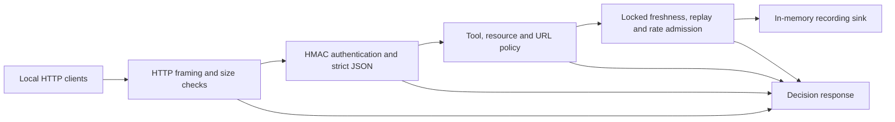

# Reproducible Security Policy Lab

A small experiment in **measuring policy violations and recorded actions**, using a local HTTP service. It exercises authenticated telemetry/tool requests, concurrent duplicate delivery, permission boundaries, request framing and input validation. One command produces machine-readable evidence and a result table.

This is a learning artifact prepared with AI assistance. It is neither novel security research nor a production security gateway. Review and rerun the code before presenting it as experience.

## Run in two minutes

Python 3.10 or newer, standard library only. Tested with Python 3.12.2 on Windows and Python 3.14.4 on Ubuntu under WSL.

```sh
python run_experiments.py
# Linux/macOS alternative:
sh run_experiments.sh
```

The run opens ephemeral loopback ports, sends actual HTTP requests, stops every server, and exits nonzero if an observed outcome or recorded-action count differs from its expected value. It makes no external network requests.

Inspect `results/latest.json` and `results/latest.md`. Committed measurements are [Windows](results/windows.md) and [Linux](results/linux.md). JSON evidence records the interpreter, platform, seed, logical clock and SHA-256 of every executable source file. Compare recorded hashes with the current files before reusing a measurement.

## What is measured

The default run has 60 scenario rows. Twenty rows are ten repeated concurrency comparisons. An eight-worker barrier makes clients start together; it does not control the OS scheduler. The random seed controls dispatch ordering only. Aggregate decisions and action counts are the repeatable observations, not a bit-for-bit thread trace.

| Condition | Full policy | Deliberately weakened variant |
|---|---|---|
| Two identical authenticated requests | 1 recorded action | 2 without replay check |
| Eight concurrent copies, repeated ten times | 1 action per trial | 8 without replay and rate checks |
| Alice targets Bob's device | Rejected, 0 actions | 1 without scope check |
| Four fresh requests within two logical seconds | 3 actions | 4 without rate check |
| Stale signed request | Rejected | Accepted without freshness check |
| Disallowed URL string | Rejected | Accepted into recording sink without URL gate |
| Same request after service restart | **Accepted again** | Known in-memory-state limitation |

The `passed` field means an expected experiment outcome matched, including intentionally insecure ablations and the restart limitation. It does not mean all 60 scenarios demonstrate secure behavior. Repeated trials are not 60 independent vulnerability classes or an estimate of real-world protection.

## Architecture and boundaries



Every credential is a public synthetic fixture. Device names, URLs and payloads are invented. The sink only appends an action to a local list. No DNS lookup, TLS connection, URL fetch, MQTT broker, LLM tool, cryptocurrency payment, hardware or applicant/employer source code is involved. URL cases establish lexical admission behavior only; they do not establish SSRF resistance against DNS rebinding or redirects.

Replay and rate admission share one lock with the recording action. State is per process. The 61-second nonce lifetime covers the permitted 30-second future clock skew plus 30-second freshness window. A separate logical-clock case checks that boundary. Restart erases replay state; the runner demonstrates this explicitly.

## Container route

```sh
docker build -t research-security-lab .
docker run --rm --network none research-security-lab
```

The image runs as a non-root user and writes evidence under `/tmp/results/`. To retain files, create a container, start it, and use `docker cp` before removing it. No host ports or credentials are needed. **Container build/run has not been verified on the preparation host because Docker Desktop's engine was unavailable.** The base version tag is specified, but the image is not pinned to a digest, so this is not a hermetic build claim. Native Windows and Ubuntu execution were verified.

## Files and next steps

Read [the research note](RESEARCH_NOTE.md), [related work](RELATED_WORK.md) and [the explanation checklist](EXPLAIN.md). Possible extensions are a transactional persistent replay ledger, multi-process delivery tests, clock changes and an instrumented network sink. None is implemented or claimed here. Ablation switches are runner-only inputs, with no HTTP endpoint to weaken the policy.
